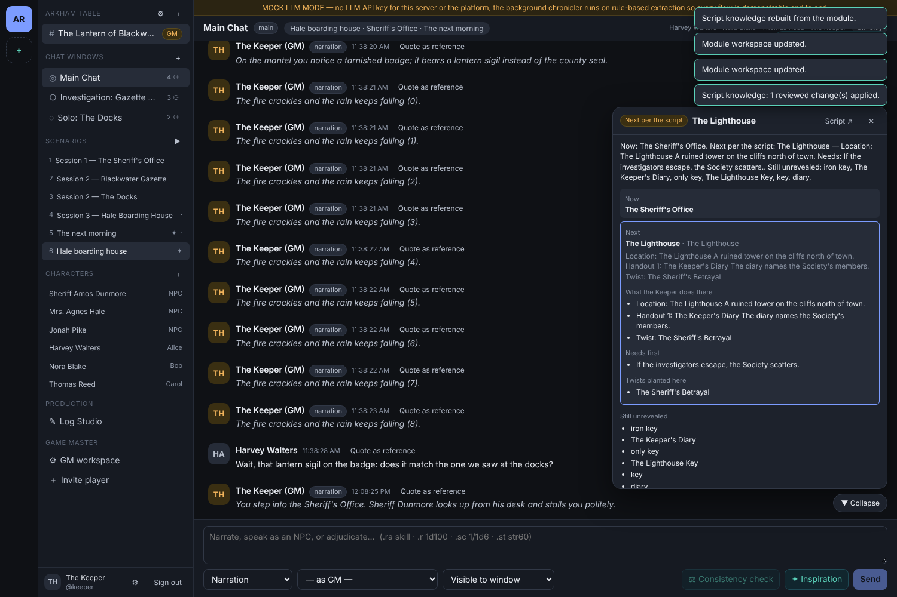
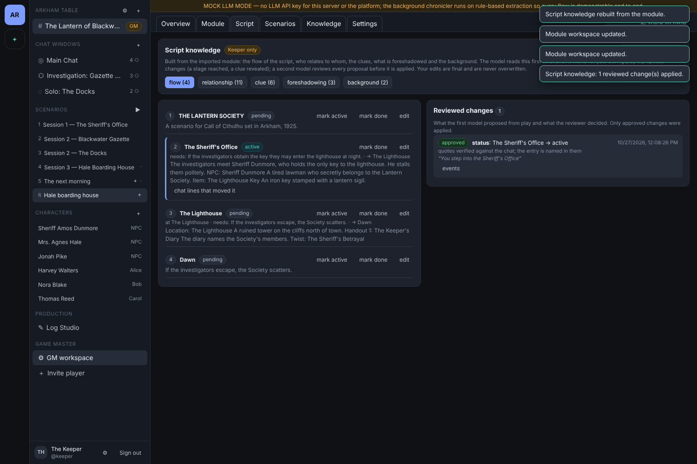
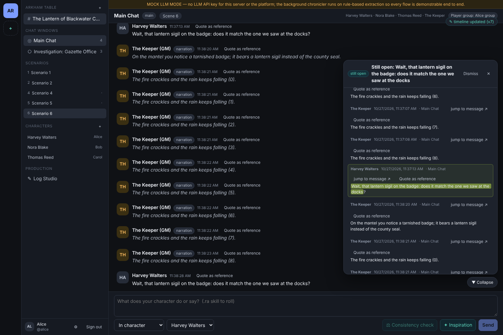
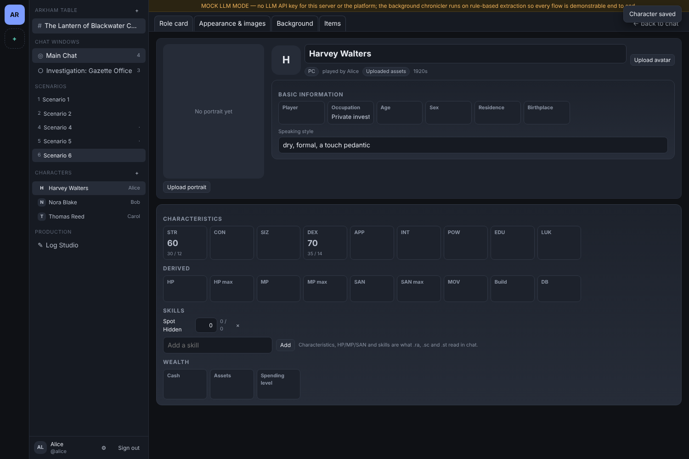
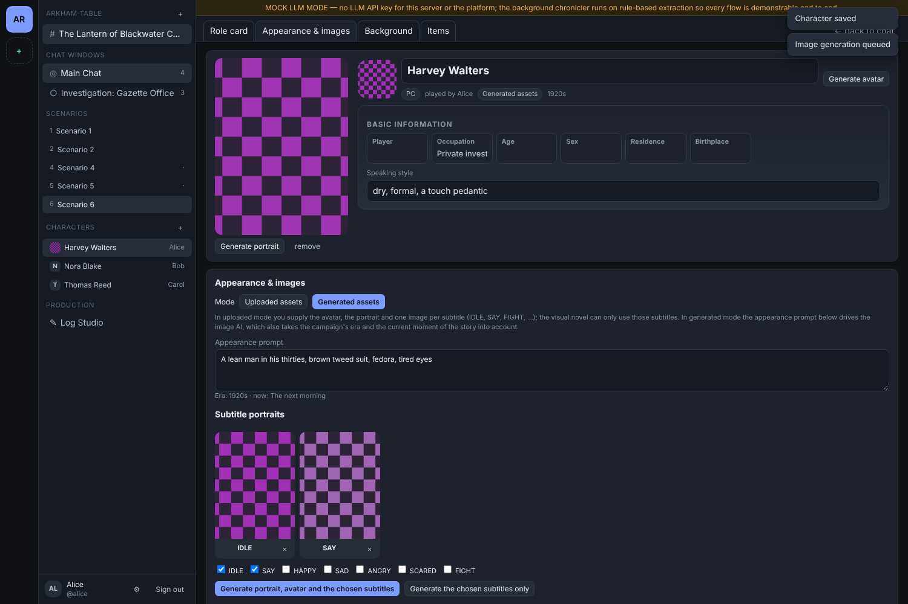
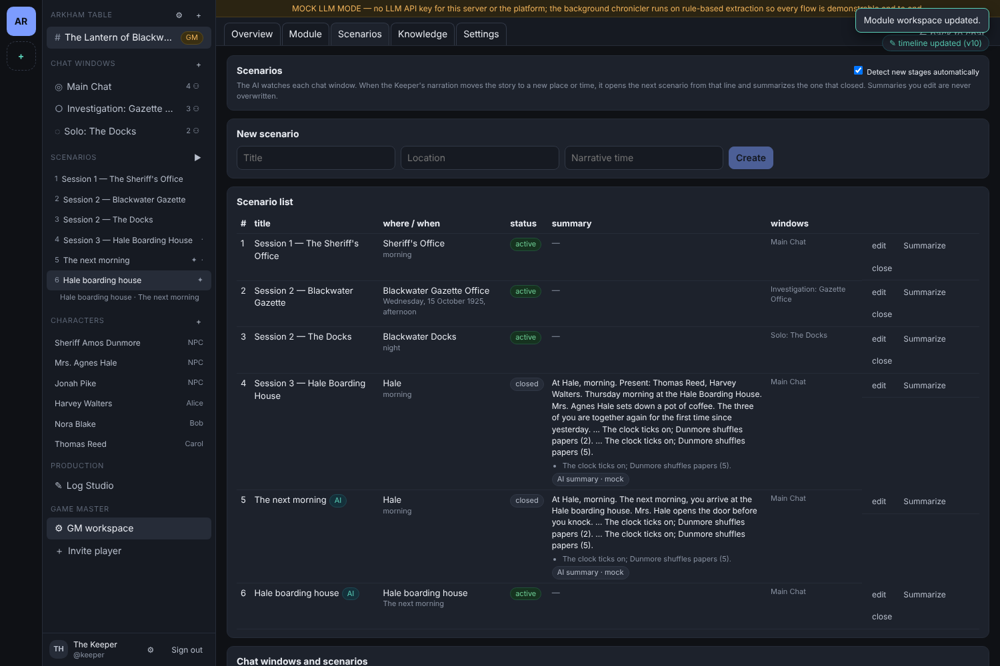

# Acerciae — AI-assisted CoC / BRP tabletop platform

A multiplayer online table for Call of Cthulhu and other Basic Roleplaying games, built around one idea:

> **The AI never speaks in the chat.** It is a silent background chronicler that watches play, keeps six living
> documents up to date with traceable, incremental changes, and surfaces attention through highlights — not messages.

| Layer | Stack |
|---|---|
| Backend | C++20, [Drogon](https://github.com/drogonframework/drogon) (HTTP + WebSocket), [libpqxx](https://github.com/jtv/libpqxx), jsoncpp, libcurl, poppler-cpp |
| Database | PostgreSQL 16 with full-text search, `pg_trgm`, optional `pgvector` |
| Frontend | React 18 + TypeScript + Vite, zustand, react-markdown |
| AI | Pluggable LLM gateway: any OpenAI-compatible chat-completions API, or a clearly labelled **Mock LLM mode** |
| Deployment | Docker Compose (db / backend / frontend / PDF worker; optional MinIO) |

Screenshots (taken from the running app in mock mode):

| Context Bubble Dock | Fluorescent highlight on an earlier clue | Consistency check |
|---|---|---|
|  |  |  |

| GM workspace | Module knowledge graph | Revision history |
|---|---|---|
|  |  |  |
| Next per the script, pinned for the Keeper | The script knowledge and its reviewed changes | A reminder bubble opened: the quoted lines highlighted |
|  |  |  |
| The character space: COC7 role card | Appearance mode, generated portrait and subtitles | The Scenarios manager |
|  |  |  |

## Quick start (Docker Compose)

```bash
cp .env.example .env            # leave LLM_API_KEY empty for Mock LLM mode, or fill in a key
# Set PDF_WORKER_TOKEN in .env to a random secret of at least 32 characters first
# openssl rand -hex 32
docker compose up --build
```

* Frontend: http://localhost:5173
* Backend API: http://localhost:8080/api/health
* A complete demonstration campaign is seeded on first start (`SEED_DEMO=true`):
  users **keeper / alice / bob / carol**, password **password**.

> Note: the Docker images were authored against the exact Ubuntu 24.04 package set used to build and test the backend in
> this repository's CI-less environment, but `docker compose build` itself was not executed in the authoring environment
> (no Docker daemon was available). See “Running without Docker” for the verified path.

## Running without Docker

Prerequisites (Ubuntu 24.04 names): `build-essential cmake ninja-build pkg-config libdrogon-dev libtrantor-dev libpqxx-dev
libpq-dev libjsoncpp-dev libpoppler-cpp-dev libcurl4-openssl-dev libssl-dev uuid-dev zlib1g-dev libbrotli-dev libhiredis-dev
libyaml-cpp-dev libsqlite3-dev libmariadb-dev` (the last one is only needed because Ubuntu's Drogon package was compiled with
MySQL support and its CMake config insists on finding the client headers; the platform itself is PostgreSQL-only),
PostgreSQL 16 (+ `postgresql-16-pgvector` optional), Node 22.13+ (or Node 24+), Chromium/Chrome and Noto CJK fonts for PDF publication.

```bash
# backend
cd backend
cmake -S . -B build -G Ninja -DCMAKE_BUILD_TYPE=Release && cmake --build build
createdb acerciae
DATABASE_URL=postgresql://postgres@localhost:5432/acerciae MIGRATIONS_DIR=./migrations UPLOAD_DIR=/tmp/acerciae-uploads ./build/acerciae-server
# frontend (dev server proxies /api and /ws to :8080)
cd ../frontend && npm install && npm run dev
```

Migrations are applied automatically at startup (`schema_migrations` table). `./build/acerciae-server --migrate-only` and
`--seed-demo` (force re-seed) are also available.

## Configuration

Everything is read from environment variables; see [`.env.example`](.env.example). Highlights:

| Variable | Meaning |
|---|---|
| `DATABASE_URL` | libpq connection string |
| `LLM_API_BASE`, `LLM_API_KEY`, `LLM_MODEL` | OpenAI-compatible endpoint. **Empty key ⇒ Mock LLM mode** (banner shown in the UI, `llm_mode: "mock"` in `/api/health`) |
| `LLM_EMBEDDING_MODEL` | optional; enables pgvector semantic retrieval (1536-dim) |
| `AI_OBSERVER_INTERVAL_MS` (5000) | scan cadence of the high-frequency observer |
| `AI_CONSOLIDATOR_INTERVAL_MS` (60000) | cadence of the low-frequency consolidation pass |
| `HIGHLIGHT_TTL_SECONDS`, `HIGHLIGHT_CLEANUP_INTERVAL_MS` | highlight lifetime and the independent expiry sweeper |
| `AUTH_SECRET` | HMAC key for API tokens and the key that seals per-server API keys (change in production; rotating it invalidates stored server keys) |

LLM API keys live only in the backend process; the frontend never sees them.

## What is implemented

**Personal settings** — Eleven interface languages matching server settings, saved per account; editable login username, Unicode display name and uploaded avatar. The sidebar profile gear opens these controls. Personal language is independent of the server's AI/dice language. See [USER_SETTINGS.md](docs/USER_SETTINGS.md) for the API and validation.

**Product structure** — Servers → Channels (one campaign each, strictly isolated context) → Chat Windows (each with
its own participants; windows and scenes are many-to-many). GM / player roles; GM-only notes and whispers.

**Document-based background assistant** — six documents per channel (`Current Scene`, `Clue Journal`,
`Relationship Journal`, `Open Threads`, `Timeline`, `Module Progress` (GM)) with stable ids, independent version numbers,
entry-level addressing, full revision history and rollback. The AI proposes incremental ops
(`add_entry`, `update_entry`, `set_status`, `append_text`, `remove_entry`, `add_relation`, `link_facts`); the backend validates
sources, permissions, epistemic status, version and conflicts before committing.

**Epistemic status is first-class** — every fact is `attempted | confirmed | npc_claim | hypothesis | ai_inferred |
gm_secret | resolved | retracted`. The validator downgrades AI "confirmed" claims that lack a GM-authored source, and turns
contradictions of confirmed records into **pending GM proposals** instead of overwriting.

**Independent memory partitions** — KP memory and each channel player group's facts, entities, documents and revisions
have separate identities. Players share their group's readable chat perspectives. A separate observer builds each group's
five journals only from that chat and its own earlier summaries; it cannot retrieve KP/module memory. KP's six categories
are available in GM Workshop, with sections, source citations, revisions and correction controls.
Group or window-access changes invalidate and rebuild the affected player summaries. Existing KP records remain intact.
See [knowledge architecture and migration](docs/KNOWLEDGE_GROUPS.md).

**One campaign log** — a channel keeps a single log of the entire campaign across every chat window, pulled from the
chat itself (nothing is imported). Everyone downloads what they may read: the lossless Acerciae JSON, a
SealDice-compatible JSON per chat window, text, HTML or a zip of all of them. PDFs and visual novels are made from this
one log.

**Character space** — every character has a page: the avatar shown in chat, the main portrait, basic information,
the COC7-styled role card (characteristics, derived values, skills, wealth), background and carried items. The Keeper and
the character's actor edit it; everyone at the table reads a PC's page. Images come from uploads or, in generated mode,
from an appearance prompt that the image AI combines with the campaign's era and the current moment of the story; one
image per subtitle (IDLE, SAY, FIGHT, …) feeds the visual novel.

**Scenarios** — the story's stages, and a campaign-wide state: every chat window is in the channel's current
scenario. Only the Keeper opens the next one (or enters a prepared one); at that moment the previous scenario closes,
gets an AI summary in the scenario list, and can only be consulted from then on. The Keeper's observer still watches the
narration: when it sees a shift of time or place it raises a "New scenario?" bubble in the Keeper's dock, anchored to the
line, but never opens one itself. Chat can be located by scenario or by time (`list_scenarios`, `get_chat_log`).
GM-edited summaries are never overwritten. Players see neutral scenario labels only.

**Keeper script knowledge** — when a module is imported, the model reads its structured graph and pages and writes the
Keeper's working knowledge: the flow of the script (its stages in order, what each needs, what the Keeper does there),
NPC and investigator relationships, clues, foreshadowing and background, each citing pages. The model reads this first
whenever it works for the Keeper. During play it proposes changes (a stage reached, a clue revealed, a twist paid off);
a second model reviews every proposal against the quoted chat lines before it is applied, and the Keeper's own edits are
final. Two cards stay pinned at the top of the Keeper's dock: what the script plans next, and the Keeper's notes (open
threads, timeline, latest reviewed changes). Keeper reminders can point at the script as well as at the chat. Nothing of
this is reachable by a player group.

**Reminder bubbles** — the players' dock no longer shows journals: their group's knowledge (relationships, clues,
open threads, and a per-scenario story index) is a hidden prelude the model reads first, a shortcut for searching.
After each batch the group's observer reads the current scenario and the end of the previous one and points out what the
players most likely forgot or need, as bubbles on the right. Every bubble is anchored to verbatim quotes from lines the
group can read (checked by `get_chat_log`; unverifiable quotes are dropped). Clicking a bubble opens the chat log around
the quoted lines with the passages highlighted in yellow-green, with jump and quote-as-reference. The Keeper keeps the six
documents.

**Scheduled AI observer** — every 5 s (configurable) per (channel, window, scene) group: cursor-based event reading, DB-level
task locks (`ai_jobs` partial unique index) plus in-process locks, batch analysis, tool-assisted retrieval, validated commit,
WebSocket notification, cursor advance. Player groups use independent generation-bound cursors and commits.
No new events ⇒ no LLM call. A separate KP consolidator runs at low frequency.

**Sharded context and the Tool API** — `get_current_scene`, `get_scene_by_id`, `search_scene_history`, `search_events`,
`get_entity`, `get_relationships`, `get_clue`, `get_open_threads`, `get_module_excerpt`, `get_knowledge_scope`, `get_shard`.
Every tool call runs under the calling identity's visibility filters (FTS + trigram, optional pgvector).

**Chat references** — players can attach up to five original messages to a new message, including from a journal source
viewer. References store IDs rather than copied excerpts; viewing or jumping to the original rechecks chat access.

**Highlights** — a separate short-lived `highlights` object bound to document entries (optionally a text range), with
reason, source events, priority, scope and expiry; pushed over the context WebSocket, fade-in in the UI, hover/click to
see why and jump to the original event, dismissable, swept by an independent cleanup loop.

**Consistency Check / Inspiration** — user-triggered only. Consistency returns a heuristic 0–100 % score (or
*Insufficient Evidence*), rationale, conflicts, traceable evidence and temporary user-scoped highlights; it never rewrites
or blocks the draft and never leaks GM-only facts. Inspiration returns an editable draft grounded only in the character's
knowledge, never auto-sent (insert / regenerate / discard).

**Integrated dice (Sealdice-compatible)** — `.r` `.rh` `.ra`/`.rc` `.rah` `.sc` `.st` `.en` typed into chat, evaluated against the
speaking character's attributes (`characters.sheet.attrs`, CoC 7e base values, English and 中文 aliases): hard/extreme
difficulty, bonus/penalty dice, sanity loss written back to SAN, hidden rolls whispered to the roller and the GM. While typing,
a gray hint follows the command (`.ra research —— Alice's research is 53`). Reply wording comes from built-in English/中文 texts
or server-defined text groups; each channel's GM picks one. GMs maintain NPC sheets by speaking as the NPC or in the character sheet.

**Server maintainers** — the server owner and admins ("maintainers") set the server's language, LLM API base/key/model and
thinking effort, TTS credentials, and switch Consistency Check, Integrated Dice and Inspiration on or off; they invite and remove
members. Keys are sealed with AES-256-GCM under `AUTH_SECRET` and never returned to clients; a server API base is only used with
the server's own key. Members are chosen with search-and-click pickers when creating chat windows, inviting to the server or a
channel, and managing an existing window's participants.

**PDF module import** — poppler text extraction per page → chunked LLM structuring into a conditional knowledge graph
(`module_nodes` / `module_edges`) with page citations → GM review/edit → progress recognition and “potential association”
hints when play touches or leaves module content. Module data is a separate GM-only layer from play events.

**Frontend** — all required components (`ServerSidebar`, `ChannelSidebar`, `ChatWindow`, `MessageList`,
`MessageComposer`, `ContextBubbleDock`, `ContextDocumentViewer`, `DocumentRevisionViewer`, `HighlightedText`,
`ConsistencyButton`, `ConsistencyResultPanel`, `InspirationButton`, `InspirationDraftPanel`, `GMWorkspace`,
`ModuleImportPanel`, `SceneManager`). Two WebSocket streams (`/ws/chat`, `/ws/context`); document bodies and highlights
live in separate stores so highlight traffic never re-renders document text; the dock collapses and never covers Send.

## Log Studio

The production workspace now supports SealDice/native import previews, alias mapping, source-preserving Canonical Logs,
versioned snapshots, styled HTML/JSON/text export, existing manually edited performances, character speech profiles,
Qwen HTTP and explicit Mock TTS, pronunciation dictionaries, selective audio cache invalidation, budgets and queued jobs.
Vivliostyle renders Classic Log, Investigation Dossier and Novel PDFs with Chinese text, covers, illustrations, configurable
page styles and permission-filtered document appendices. Published styled logs, existing performances and PDFs freeze their
content/resources and support revocable sharing. Style/character profiles, uploaded assets, candidate image generation and
reviewed delivery suggestions reuse the same campaign context without modifying historical facts.

Automatic visual-novel template generation is intentionally deferred. Real Qwen and image HTTP adapters are implemented,
but paid-service credentials were not available for live verification. Mock TTS produces labelled tone WAVs; Mock images are
labelled procedural test patterns. They do not pretend to be real voices/artwork. The image HTTP adapter requires a gateway
matching the documented contract. Local Qwen3 inference, video/FFmpeg export and pixel-perfect generated identity are not
implemented. Docker/MinIO deployment has not been executed here; the local C++/PostgreSQL/Node path was tested.

Open Log Studio → Library to create/import a project and select a snapshot. The GM can set the character budget and enable
cloud processing under Campaign production settings (disabled by default). Configure provider credentials/region in server
settings or the backend environment. A separate PDF worker must be running for PDF jobs to leave pending state:

```bash
npm --prefix pdf-worker ci
# Set the same PDF_WORKER_TOKEN on the backend and this worker.
API_BASE=http://127.0.0.1:8080 PDF_WORKER_TOKEN="$PDF_WORKER_TOKEN" node pdf-worker/src/index.mjs
```

On the Visual novel tab any member can make a visual novel in four steps: the LLM reads the campaign log in their scope
as time blocks and writes the script (backgrounds and portrait subtitles, never new text), the image AI paints missing
backgrounds and generated-mode portraits, the author casts a voice for every character and the narration (Qwen TTS),
and a zip with a standalone HTML player, the images and the voice lines downloads for offline viewing. The server
maintainer can turn the Log Studio off, and the Keeper can hide it per channel. See
[visual novel guide](docs/VISUAL_NOVEL.md).

A server maintainer can switch on **COC7 point-buy** (Server settings → Features): role cards then show the
characteristic total, take a career from the built-in list of 230 (credit-rating range, points formula, career skills,
option groups and free specialties, generated from the community COC7 sheet), and split skill investment into career
points (career skills only) and hobby points (INT×2, any skill) with the limits enforced on save. See
[COC7 point-buy](docs/COC7_POINT_BUY.md).

See [Log Studio guide](docs/LOG_STUDIO.md), [speech provider](docs/TTS_PROVIDER.md), [media/generation](docs/ASSETS.md),
[PDF templates](docs/PDF_TEMPLATES.md), and [example fixtures](examples/logstudio/README.md). `docs/API.md` includes the
shared mobile-facing contracts; `mobile/` development is maintained independently.

## Tests

```bash
scripts/test.sh                      # unit + DB + end-to-end + typecheck against a local PostgreSQL
# or individually
backend/build/unit_tests             # no DB needed
(cd backend && TEST_DATABASE_URL=postgresql://postgres@localhost:5432/acerciae_test ./build/db_tests)
API_BASE=http://localhost:8080 node --test tests/integration/scenarios.test.mjs
npm --prefix pdf-worker test
API_BASE=http://localhost:18081 node --test tests/integration/logstudio.test.mjs  # isolated mock server + real PDF worker
```

See [docs/ACCEPTANCE_SCENARIOS.md](docs/ACCEPTANCE_SCENARIOS.md) for how each mandated scenario is exercised and how to
reproduce it by hand with the demo campaign.

## Documentation

* [docs/ARCHITECTURE.md](docs/ARCHITECTURE.md) — modules, data model, permission model, schedulers
* [docs/DATA_FLOW.md](docs/DATA_FLOW.md) — the vertical flow from message to highlighted document, proposal validation
* [docs/API.md](docs/API.md) — HTTP and WebSocket reference
* [docs/ACCEPTANCE_SCENARIOS.md](docs/ACCEPTANCE_SCENARIOS.md) — the seven scenarios

## Known limitations (explicitly out of the MVP)

* **Mock LLM mode is rule-based.** It demonstrates every pipeline end to end and is deterministic, but its extraction is
  heuristic English pattern matching; the live mode uses the same prompts, schemas, tools and validators with a real model.
* Semantic (pgvector) retrieval is wired but only active when `LLM_EMBEDDING_MODEL` is set; FTS + trigram is the default.
* Timeline compression and relationship merging in the consolidator are conservative (resolve promise threads, drop exact
  duplicate relationships); richer long-term compression is left to the live model.
* Group membership is managed explicitly by the KP. Changing it rebuilds derived player journals from currently readable
  chat; the AI never directly shares or copies KP facts. Public/isolated channel mode controls new-player allocation.
* Database access is synchronous on Drogon's IO threads (pooled libpqxx connections); adequate for table-sized loads,
  not tuned for very large deployments. Multi-instance deployment is possible (locks and cursors live in PostgreSQL;
  WebSocket fan-out is per instance and would need a broker for cross-instance pushes).
* The Node e2e suite uses the `ws` package because Node's built-in WebSocket reuses pooled HTTP connections, which Drogon
  does not upgrade (browsers always open a fresh connection, so the product is unaffected).
