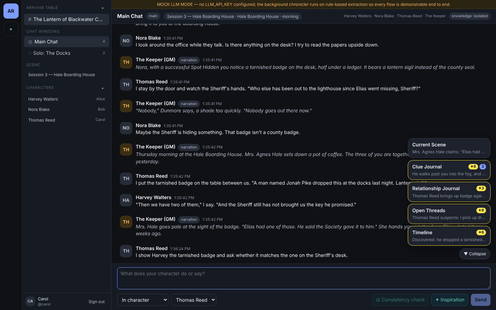
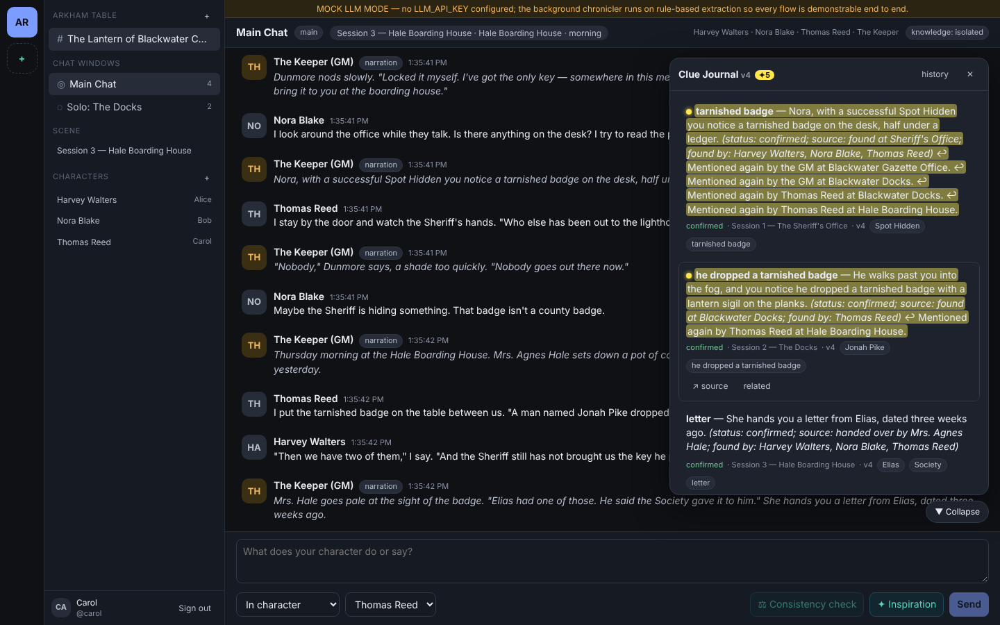
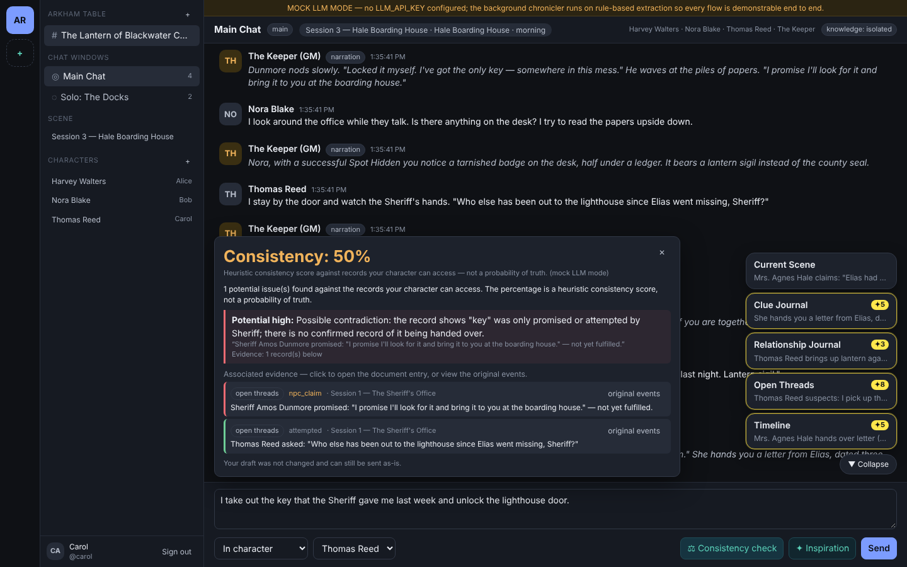
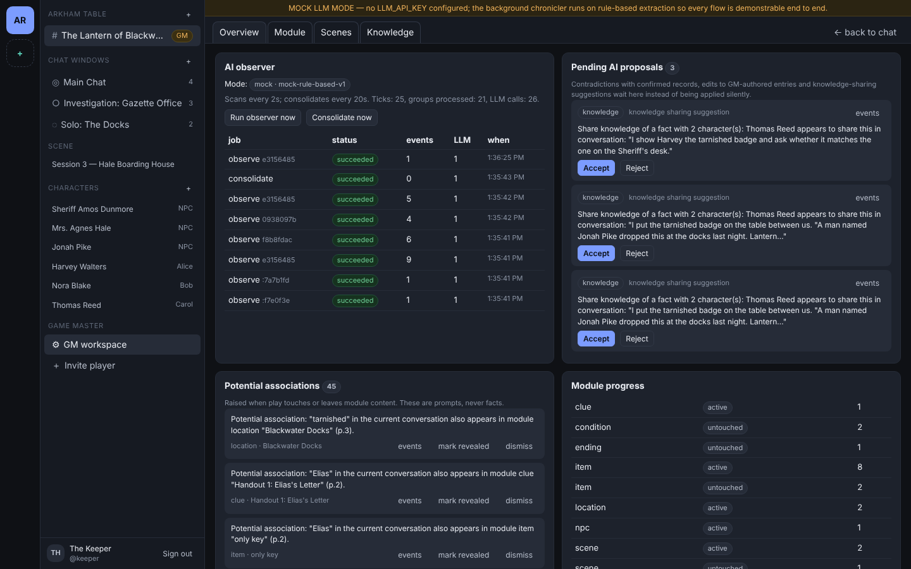
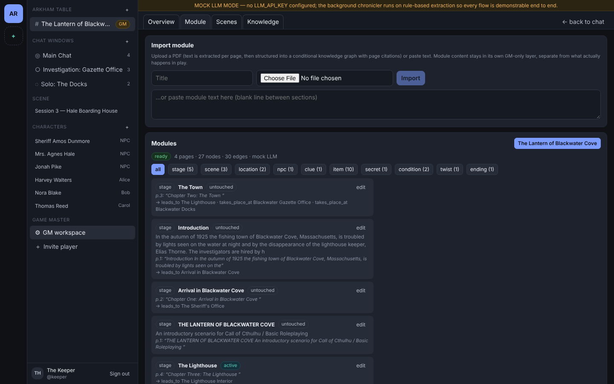
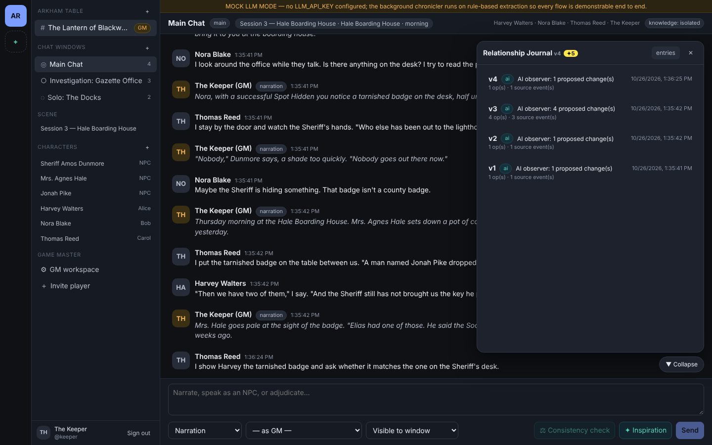

# Acerciae — AI-assisted CoC / BRP tabletop platform

A multiplayer online table for Call of Cthulhu and other Basic Roleplaying games, built around one idea:

> **The AI never speaks in the chat.** It is a silent background chronicler that watches play, keeps six living
> documents up to date with traceable, incremental changes, and surfaces attention through highlights — not messages.

| Layer | Stack |
|---|---|
| Backend | C++20, [Drogon](https://github.com/drogonframework/drogon) (HTTP + WebSocket), [libpqxx](https://github.com/jtv/libpqxx), jsoncpp, libcurl, poppler-cpp |
| Database | PostgreSQL 16 with full-text search, `pg_trgm`, optional `pgvector` |
| Frontend | React 18 + TypeScript + Vite, zustand, react-markdown |
| AI | Pluggable LLM gateway: any OpenAI-compatible chat-completions API, or a clearly labelled **Mock LLM mode** |
| Deployment | Docker Compose (db / backend / frontend) |

Screenshots (taken from the running app in mock mode):

| Context Bubble Dock | Fluorescent highlight on an earlier clue | Consistency check |
|---|---|---|
|  |  |  |

| GM workspace | Module knowledge graph | Revision history |
|---|---|---|
|  |  |  |

## Quick start (Docker Compose)

```bash
cp .env.example .env            # leave LLM_API_KEY empty for Mock LLM mode, or fill in a key
docker compose up --build
```

* Frontend: http://localhost:5173
* Backend API: http://localhost:8080/api/health
* A complete demonstration campaign is seeded on first start (`SEED_DEMO=true`):
  users **keeper / alice / bob / carol**, password **password**.

> Note: the Docker images were authored against the exact Ubuntu 24.04 package set used to build and test the backend in
> this repository's CI-less environment, but `docker compose build` itself was not executed in the authoring environment
> (no Docker daemon was available). See “Running without Docker” for the verified path.

## Running without Docker

Prerequisites (Ubuntu 24.04 names): `build-essential cmake ninja-build pkg-config libdrogon-dev libtrantor-dev libpqxx-dev
libpq-dev libjsoncpp-dev libpoppler-cpp-dev libcurl4-openssl-dev libssl-dev uuid-dev zlib1g-dev libbrotli-dev libhiredis-dev
libyaml-cpp-dev libsqlite3-dev libmariadb-dev` (the last one is only needed because Ubuntu's Drogon package was compiled with
MySQL support and its CMake config insists on finding the client headers; the platform itself is PostgreSQL-only),
PostgreSQL 16 (+ `postgresql-16-pgvector` optional), Node 20+.

```bash
# backend
cd backend
cmake -S . -B build -G Ninja -DCMAKE_BUILD_TYPE=Release && cmake --build build
createdb acerciae
DATABASE_URL=postgresql://postgres@localhost:5432/acerciae MIGRATIONS_DIR=./migrations UPLOAD_DIR=/tmp/acerciae-uploads ./build/acerciae-server
# frontend (dev server proxies /api and /ws to :8080)
cd ../frontend && npm install && npm run dev
```

Migrations are applied automatically at startup (`schema_migrations` table). `./build/acerciae-server --migrate-only` and
`--seed-demo` (force re-seed) are also available.

## Configuration

Everything is read from environment variables; see [`.env.example`](.env.example). Highlights:

| Variable | Meaning |
|---|---|
| `DATABASE_URL` | libpq connection string |
| `LLM_API_BASE`, `LLM_API_KEY`, `LLM_MODEL` | OpenAI-compatible endpoint. **Empty key ⇒ Mock LLM mode** (banner shown in the UI, `llm_mode: "mock"` in `/api/health`) |
| `LLM_EMBEDDING_MODEL` | optional; enables pgvector semantic retrieval (1536-dim) |
| `AI_OBSERVER_INTERVAL_MS` (5000) | scan cadence of the high-frequency observer |
| `AI_CONSOLIDATOR_INTERVAL_MS` (60000) | cadence of the low-frequency consolidation pass |
| `HIGHLIGHT_TTL_SECONDS`, `HIGHLIGHT_CLEANUP_INTERVAL_MS` | highlight lifetime and the independent expiry sweeper |
| `AUTH_SECRET` | HMAC key for API tokens (change in production) |

LLM API keys live only in the backend process; the frontend never sees them.

## What is implemented

**Product structure** — Servers → Channels (one campaign each, strictly isolated context) → Chat Windows (each with
its own participants; windows and scenes are many-to-many). GM / player roles; GM-only notes and whispers.

**Document-based background assistant** — six documents per channel (`Current Scene`, `Clue Journal`,
`Relationship Journal`, `Open Threads`, `Timeline`, `Module Progress` (GM)) with stable ids, independent version numbers,
entry-level addressing, full revision history and rollback. The AI proposes incremental ops
(`add_entry`, `update_entry`, `set_status`, `append_text`, `remove_entry`, `add_relation`, `link_facts`); the backend validates
sources, permissions, epistemic status, version and conflicts before committing.

**Epistemic status is first-class** — every fact is `attempted | confirmed | npc_claim | hypothesis | ai_inferred |
gm_secret | resolved | retracted`. The validator downgrades AI "confirmed" claims that lack a GM-authored source, and turns
contradictions of confirmed records into **pending GM proposals** instead of overwriting.

**Fact–Knower model** — `knowledge_facts` + `knowledge_visibility` record *who knows what* (GM / public / per character).
Scope is derived from the audience of the cited events (intersection), so a secret never widens by itself. Mode A
(public knowledge) and Mode B (character isolation) per channel; v1 knowledge-sharing suggestions for the GM to confirm.

**Scheduled AI observer** — every 5 s (configurable) per (channel, window, scene) group: cursor-based event reading, DB-level
task locks (`ai_jobs` partial unique index) plus in-process locks, batch analysis, tool-assisted retrieval, validated commit,
WebSocket notification, cursor advance. No new events ⇒ no LLM call. A separate consolidator runs at low frequency.

**Sharded context and the Tool API** — `get_current_scene`, `get_scene_by_id`, `search_scene_history`, `search_events`,
`get_entity`, `get_relationships`, `get_clue`, `get_open_threads`, `get_module_excerpt`, `get_knowledge_scope`, `get_shard`.
Every tool call runs under the calling identity's visibility filters (FTS + trigram, optional pgvector).

**Highlights** — a separate short-lived `highlights` object bound to document entries (optionally a text range), with
reason, source events, priority, scope and expiry; pushed over the context WebSocket, fade-in in the UI, hover/click to
see why and jump to the original event, dismissable, swept by an independent cleanup loop.

**Consistency Check / Inspiration** — user-triggered only. Consistency returns a heuristic 0–100 % score (or
*Insufficient Evidence*), rationale, conflicts, traceable evidence and temporary user-scoped highlights; it never rewrites
or blocks the draft and never leaks GM-only facts. Inspiration returns an editable draft grounded only in the character's
knowledge, never auto-sent (insert / regenerate / discard).

**PDF module import** — poppler text extraction per page → chunked LLM structuring into a conditional knowledge graph
(`module_nodes` / `module_edges`) with page citations → GM review/edit → progress recognition and “potential association”
hints when play touches or leaves module content. Module data is a separate GM-only layer from play events.

**Frontend** — all required components (`ServerSidebar`, `ChannelSidebar`, `ChatWindow`, `MessageList`,
`MessageComposer`, `ContextBubbleDock`, `ContextDocumentViewer`, `DocumentRevisionViewer`, `HighlightedText`,
`ConsistencyButton`, `ConsistencyResultPanel`, `InspirationButton`, `InspirationDraftPanel`, `GMWorkspace`,
`ModuleImportPanel`, `SceneManager`). Two WebSocket streams (`/ws/chat`, `/ws/context`); document bodies and highlights
live in separate stores so highlight traffic never re-renders document text; the dock collapses and never covers Send.

## Tests

```bash
scripts/test.sh                      # unit + DB + end-to-end + typecheck against a local PostgreSQL
# or individually
backend/build/unit_tests             # no DB needed (71 checks)
TEST_DATABASE_URL=postgresql://postgres@localhost:5432/acerciae_test backend/build/db_tests
API_BASE=http://localhost:8080 node --test tests/integration/scenarios.test.mjs   # the 7 acceptance scenarios + realtime
```

See [docs/ACCEPTANCE_SCENARIOS.md](docs/ACCEPTANCE_SCENARIOS.md) for how each mandated scenario is exercised and how to
reproduce it by hand with the demo campaign.

## Documentation

* [docs/ARCHITECTURE.md](docs/ARCHITECTURE.md) — modules, data model, permission model, schedulers
* [docs/DATA_FLOW.md](docs/DATA_FLOW.md) — the vertical flow from message to highlighted document, proposal validation
* [docs/API.md](docs/API.md) — HTTP and WebSocket reference
* [docs/ACCEPTANCE_SCENARIOS.md](docs/ACCEPTANCE_SCENARIOS.md) — the seven scenarios

## Known limitations (explicitly out of the MVP)

* **Mock LLM mode is rule-based.** It demonstrates every pipeline end to end and is deterministic, but its extraction is
  heuristic English pattern matching; the live mode uses the same prompts, schemas, tools and validators with a real model.
* Semantic (pgvector) retrieval is wired but only active when `LLM_EMBEDDING_MODEL` is set; FTS + trigram is the default.
* Timeline compression and relationship merging in the consolidator are conservative (resolve promise threads, drop exact
  duplicate relationships); richer long-term compression is left to the live model.
* Intelligent knowledge grouping is v1: the observer proposes sharing when a character talks about a private fact in front
  of others; the GM confirms. No automatic merging on reunion.
* Database access is synchronous on Drogon's IO threads (pooled libpqxx connections); adequate for table-sized loads,
  not tuned for very large deployments. Multi-instance deployment is possible (locks and cursors live in PostgreSQL;
  WebSocket fan-out is per instance and would need a broker for cross-instance pushes).
* The Node e2e suite uses the `ws` package because Node's built-in WebSocket reuses pooled HTTP connections, which Drogon
  does not upgrade (browsers always open a fresh connection, so the product is unaffected).
