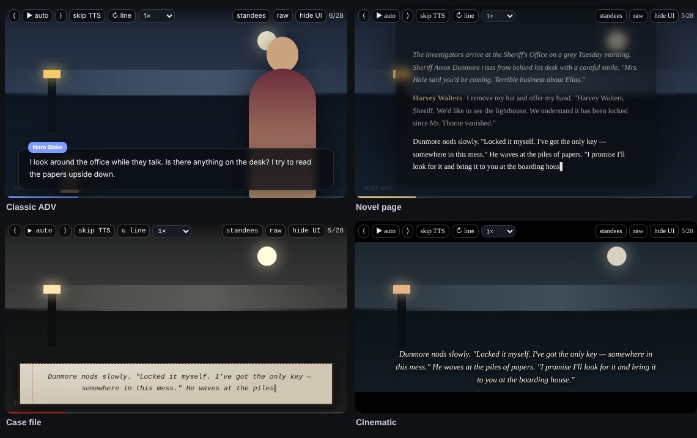
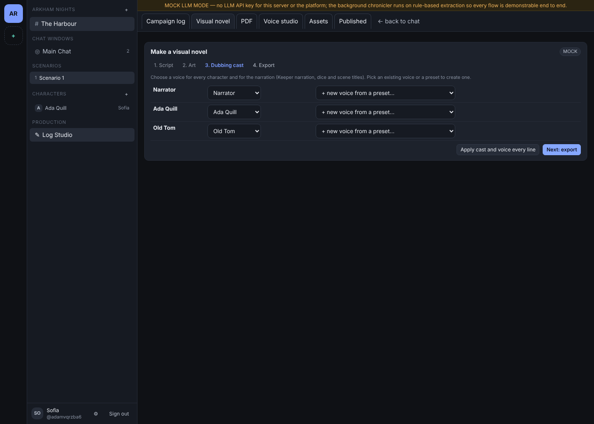
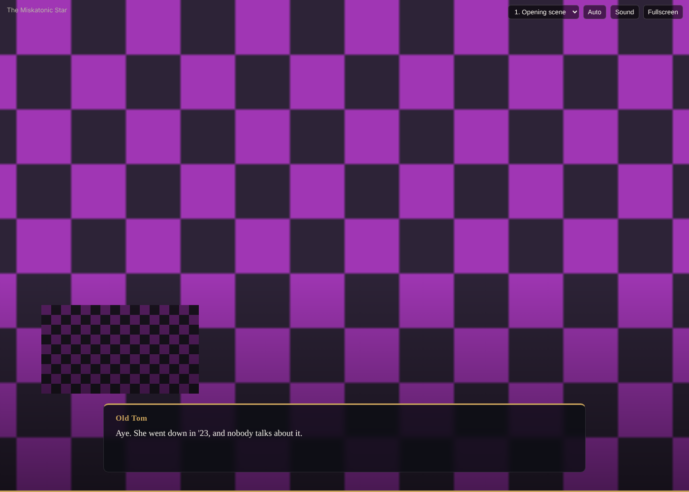

# Visual novel: look templates, LLM scripts and the standalone bundle

A visual novel in Log Studio is a presentation over one frozen snapshot. Two features shape it:

- **Look templates** decide how the player draws every line.
- **Script jobs** have the LLM read the campaign log in the requester's scope and organise it into scenes, backgrounds and portraits. The job then builds a draft presentation in a chosen template, asks the image AI for missing art, and the author casts voices and downloads a standalone zip.

Neither feature changes canonical text. A script references log events by id. The script editor (the model) is told to
edit boldly: the script is the story of the session, not a transcript. It may give a line its own wording for the
visual novel, stored on the presentation (`script_text`) while the log keeps the original:

- the Keeper's narration and action lines are rewritten as fluent prose in the log's language;
- in-character dialogue is smoothed into literary dialogue (typos, grammar, chat shorthand and broken sentences are
  fixed, each character's voice is kept);
- short question-and-answer exchanges ("Is the door locked?" / "Yes.") fold into one narration line ("The door is
  locked."); the folded lines stay in the presentation, hidden with the reason `folded into narration (L<n>)`;
- dice lines are never reworded.

Exact wording is not kept, but facts, names, numbers and decisions are, and the editor never invents events. Only
consecutive lines of one chat window with the same readers can fold together, so a reworded line never carries text its
viewer could not read. The editor shows the wording with the log's original beside it ("Use the log's wording" restores
it), and the player's raw log view always shows the canonical text.

The editor also leaves lines out, each listed under `exclude` with a short reason (the line stays in the presentation,
hidden with that reason, never deleted):

- out-of-character chatter, whether or not the log labels it OOC (scheduling, rules talk, jokes about the game,
  reactions to dice, "brb");
- messages posted by a bot's program (log start or end banners, help and command instructions, bot status, echoed
  commands), except dice results, which stay. Local logs from dice bots carry these on every session;
- messages that are plainly not part of the play: placeholders such as "MISSPELL" or "ignore that" left behind by an
  edit, resends and corrections of a line, accidental pastes, withdrawn messages;
- scene markers that only repeat the previous one.

Every other line is placed. When a decision belongs to the players or the Keeper (whether a line is in character,
whether two names are one person, whether a message was meant, how to read an ambiguous line), the editor does not
guess: it asks, see [Questions from the editor](#questions-from-the-editor).



## Look templates

A presentation stores its template in `settings.template`: a base preset plus optional overrides. Keys that are absent take the preset's value, so a later change to a preset reaches presentations that never overrode it. The backend validates every value and drops unknown keys (`PresentationService::validateVnTemplate`). The player re-checks values and turns them only into enumerated class names, clamped numbers and `#RRGGBB` colours. No template value can carry free CSS, HTML or URLs.

| Base | Look | Defaults that differ from Classic ADV |
|---|---|---|
| `adv` Classic ADV | Bottom text box, floating name tag, standees in front | None |
| `nvl` Novel page | Full-height page; the scene's earlier lines stay above the current one | Serif, names inline, dice inline, corner caption for scene titles |
| `dossier` Case file | Typewritten paper slip with a red margin rule over a sepia scene; rolls are stamped | Typewriter face, sepia grade, stamp dice, corner caption |
| `cinematic` Cinematic | Letterbox bars, subtitles without a box | Serif, larger text, names in small caps, cold grade, letterbox |

| Key | Values | Meaning |
|---|---|---|
| `base` | `adv` · `nvl` · `dossier` · `cinematic` | Preset (required) |
| `font` | `sans` · `serif` · `mono` | Typeface family; CJK fallbacks included |
| `text_scale` | 0.8–1.5 | Text size relative to the stage width |
| `box_opacity` | 0–1 | Text box background |
| `accent_color` | `#RRGGBB` | Default name tag, highlighted words, progress bar |
| `name_style` | `tag` · `inline` · `hidden` | Speaker name placement |
| `color_grade` | `none` · `sepia` · `mono` · `cold` · `warm` | Filter on background and standees, never on text |
| `letterbox` | boolean | Black bars above and below |
| `dim_inactive` | boolean | Darken standees that are not speaking |
| `portrait_framing` | `upper` · `full` | `upper` (every preset's default): standees sit lower and only their upper half shows; `full`: the whole figure |
| `dice_style` | `burst` · `stamp` · `inline` · `hide` | How a roll's total and outcome appear |
| `scene_card` | `fade` · `caption` · `none` | How a new scene's title appears |
| `character_colors` | character id → `#RRGGBB` (≤ 200) | Name colours |

A speaker's name colour comes from the line's own `dialogue_style.name_color`, then from `character_colors`, then from the character's visual profile colour, then from the accent. Text sizes scale with the stage through container query units, so the editor preview and fullscreen keep the same proportions. In the editor, the **Look template** panel under the preview shows the four presets and every override. Changes apply to the preview at once and save half a second after the last edit. Publications copy the presentation, so a published visual novel keeps the template it had when it was published.

## Making a visual novel

Any member can make a visual novel when the Log Studio is open (see [Who can use the Studio](#who-can-use-the-studio)).
The **Make a visual novel** card on the Visual novel tab has four steps.



1. **Script.** Choose the **point of view**: everything (Keeper only; the result is Keeper only), lines public to every
   player, or one character's point of view (a player's own characters only). It decides who may watch the result and
   which lines anyone may read. Then tick the **chat windows to tell**: every window the point of view can read is
   listed with its number of lines (`GET /vn-scripts/windows`), and the windows you leave out are not told. A window
   the point of view reads nothing of is shown greyed out; a player sees only the windows they are in or can read.
   Scene changes that belong to no window always stay. The request freezes the campaign log in that scope, narrowed to
   those windows, and queues `POST /vn-scripts`; a continuation tells the same windows (those that still exist). A
   worker writes the script and builds a draft presentation.
2. **Art.** Scenes without an approved background, and portraits the script asks for, are painted by the image AI and
   land in the draft as they finish. Characters in uploaded mode use only the portraits their players uploaded.
3. **Dubbing cast.** Pick a voice for every speaking character and for the narration (Keeper narration, dice and scene
   titles), or create one from a provider preset. **Apply cast and voice every line** stores the cast on the draft
   (`POST /presentations/{p}/cast`) and starts a TTS job (Qwen TTS, or the mock provider).
4. **Export.** Preview the draft, open it in the advanced editor, or prepare a download: the zip is packed in the
   background (`POST /presentations/{p}/bundle`), stored for `VN_BUNDLE_TTL_HOURS` (default 24; in the public R2
   bucket when one is configured, Keeper-only presentations included) and deleted when it expires. It holds `index.html`, `script.json`, every image under `assets/` and every
   voice line under `audio/`. The page plays offline in any browser: click, space or arrow keys advance; `A` auto-plays
   with the voices, `M` mutes, `F` goes fullscreen, and a menu jumps between scenes.



### Continuing a visual novel as the story goes on

A finished visual novel can be continued with the lines posted after its last one. In the job list, **Continue the
story** on the newest job of a presentation (its author or the Keeper) sends `POST /vn-scripts
{continue_presentation_id, instructions?, allow_cloud?, generate_art?}`:

1. The campaign log is frozen again in the presentation's own scope (the same point of view). The new lines are those
   after the last line the presentation holds; when there are none the request is refused (400). Only one
   continuation of a presentation runs at a time (409).
2. The worker plans only the new lines, as usual, with three additions:
   - The system prompt adds the continuation rules: carry on from where the story ended, reuse the existing
     backgrounds and portrait subtitles by their exact names, and ask only for places and poses that are new.
   - The first part starts with `# Story so far`: the scene the story ended on, its background name and its last
     eight shown lines (only lines the requester may read). They are context and are never scripted again.
   - The asset list includes the presentation's own backgrounds under their scene names, even Keeper-only generated
     ones the presentation already shows. Scenes still waiting for a picture are listed by name with their prompt.
3. The new scenes are appended to the same presentation, which now reads the newer snapshot. Old scenes and lines,
   with their edits and voice lines, are untouched. The first new scene joins the last old one when it plays on the
   same background. A later scene named like an old pictured one takes that picture. New scene keys never collide
   with old ones, and no background is generated for a scene that already has one.
4. The stored dubbing cast voices the new lines. Run **Apply cast and voice every line** again to record them; lines
   already voiced are reused from the cache.

The job lists `continues_presentation_id`, and its `script` holds the new lines only.

The desktop Open Log Studio does the same with a supplement log (see [desktop/README.md](../desktop/README.md)).

### Questions from the editor

A part's answer may carry up to five `questions` (`{id, question, refs, options}`, in the log's own language) next to
its best script for the part. The job then does not stop: the other parts are written as usual, and when the loop ends
with questions open the job's status becomes `waiting`. `GET …/vn-scripts/{j}` lists them under `questions`
(`[{part_index, first_line, last_line, items, answered, answers}]`) and the Studio shows a question box under the job:
each question with the lines it is about, its suggested options as buttons, a free-text answer, **Answer and continue**
and **Skip (use the draft)**. The author or the Keeper answers through `POST …/vn-scripts/{j}/answers` with
`{part_index, answers: {q1: "…"}}` or `{part_index, skip: true}`; questions left unanswered are the editor's own call
("no answer; decide yourself"). Parts can be answered in any order; the job runs again once every open part has an
answer, and only those parts are redone: the finished parts are reused from their checkpoints (a resumed part does not
change the prompts of the parts after it), so answering never costs the rest of the script again. A skipped part keeps
the editor's draft, with a note in the script. A resumed part may ask once more; after two rounds its draft is used.
Cancelling a waiting job works as for a running one; a changed model or endpoint keeps the answers (the lines are the
same) and replays the turn as plain text.

Resuming a part continues the model's own conversation: the part's prompt, the model's earlier answer as its assistant
turn, then the answers as a new user turn (`# Answers to your questions about this part …`, asking for the complete
JSON again). The model's turn is stored as the provider returned it (`vn_script_chunks.exchange`), because providers
verify the hidden reasoning they return:

- **Anthropic.** `thinking` blocks are replayed only unmodified, with their `signature`, and only to the model that
  signed them; `redacted_thinking` blocks need their `data`. Anything else of the reasoning is dropped; the text block
  always goes back.
- **OpenAI Responses.** Requests are sent with `store: false`, so the reasoning of a turn is only replayable in its
  sealed form: VN requests to OpenAI's own API ask for `include: ["reasoning.encrypted_content"]`, and a `reasoning`
  item is replayed only with that content and to the same model, next to the `message` item. Other compatible gateways
  are not sent the field and get the text only.
- A provider that still rejects the replayed turn (HTTP 400) gets the answers appended to the part's prompt instead,
  with no assistant turn.

The same rules live in `backend/src/llm/Replay.cpp` for the server and `frontend/src/openstudio/vn/replay.ts` for the
desktop Open Log Studio, whose composer keeps the waiting parts in the project (`vn_draft`, with the model's turn) until
they are answered in the Visual novel panel; its chat-completions adapter replays text only (a gateway's
`reasoning_content` must never be sent back), its Anthropic adapter the signed blocks.

### The transcript the model reads

The log is cut into **time blocks**: a block ends when no chat window carried a line for an hour. One model call reads one
block (a long block is split into consecutive parts). Each call gets two messages. The first is the same, byte for byte,
for every part of a job, so the provider can serve it from its prompt cache (see Prompt caching in
[ARCHITECTURE.md](ARCHITECTURE.md)):

```
GM direction (data): Keep the investigation scenes tense.
# Assets
Era: 1920s New England
Portraits:
- C1 "Ada Quill" mode=generated subtitles=[IDLE] prompt="red-haired librarian in a grey coat"
- C2 "Mo Reyes" mode=uploaded subtitles=[IDLE, FIGHT] (uploaded: only these subtitles may be used)
Backgrounds:
- "Harbour at night" (existing)
```

The second holds what belongs to the part: backgrounds that earlier parts asked for, the story so far (first part of a
continuation), the part number and its lines:

```
# Backgrounds generated in earlier parts
- "Lighthouse" prompt="1920s lighthouse at night"
Part 2 of 3
# Block (2026-10-27 21:02 – 2026-10-27 22:40)
## Window: Main table
[L1] KP(Narrative)(21:02): Fog rolls over the harbour.
[L2] Mo Reyes(21:03): I keep watch on the pier.
[L3] Mo Reyes(OOC)(21:04): brb, coffee
[L4] KP(as Old Tom)(21:05): Storm's coming.
## Window: Archive (private)
[L5] Ada Quill(21:03): I pull the 1923 ledger.
```

The model answers:

```json
{"generate_backgrounds": [{"name": "Archive", "prompt": "1920s university archive, lamplight, no people"}],
 "generate_portraits": [{"char": "C1", "subtitle": "SAY", "prompt": "…, speaking, full-body standee"}],
 "script": [{"ref": "L1", "background": "Harbour at night"},
            {"ref": "L2", "speaker": "C2", "background": "Harbour at night", "portrait": "IDLE"}]}
```

- **Cast.** Only characters who speak in the frozen lines, or whose full name appears in them, are listed, so a player's
  script cannot name an NPC they have not met.
- **Backgrounds.** Approved backgrounds the scope may show are listed as existing. A snapshot that is not `gm_full` never
  sees GM-only images.
- **Direction.** An optional direction of at most 1,000 characters goes in as data.

The system prompt forbids writing, rewriting, translating, shortening or merging lines, and forbids inventing facts.

### What is accepted from the model

`VnScriptService::fromFlat` turns the answers into scenes, and `normalize` validates them:

- **Scenes.** A new scene opens whenever the background changes; its title is the background name. Parallel chat windows
  therefore read as separate scenes when the model gives them different backgrounds.
- **Lines.** Only refs that exist are placed, each once. An answer that copied a line's text instead of its ref is matched
  back to that line. Lines listed under `exclude` are hidden with the given reason (a placed line stays placed; a
  missing reason reads `left out by the script editor`); out-of-character and system lines the model simply leaves out
  are hidden with a reason too, never deleted. Story lines it skips without a reason stay visible next to their
  neighbours.
- **Questions.** `questions` are read (at most five, bounded) and make the part wait for the user, see above; they are
  never part of the script.
- **Portraits.** A speaker is staged with the subtitle given (at most two on stage). For a character in uploaded mode a
  subtitle not in their list falls back to their default art. Portrait requests for uploaded-mode characters are dropped.
- **Art requests.** New backgrounds and generated-mode portraits become image jobs (`asset_needs`, at most 24 per script).
  Background jobs attach to their scene; portrait jobs are added to the character space (when the Keeper or the
  character's actor asked) and show on every placement of that character with that subtitle at once.

`PresentationService::applyScript` writes the result over a fresh presentation. It re-checks each background and BGM
(approved, same channel, right type, visible to the presentation's audience).

### Character images: one per character and subtitle
- **A stage names a character and a subtitle, never an image.** A placement is stored as
  `{character_id, expression, position, …}`; when the presentation is read (editor, player, publication, zip) each one
  gets `asset_id`/`asset_version` of the character's current image for that subtitle: the character space's image,
  else the newest approved library standee filed under that character and subtitle, else the main portrait. Updating
  a pose updates every visual novel that uses it. Migration `0039` converted older placements.
- **A new image deletes the older one.** Uploading or generating a character's avatar, main portrait or a subtitle pose
  (in the character space, by a script's art request, or a library upload with that character and subtitle by the
  Keeper or the character's actor) replaces the slot and deletes the previous image of the same character and subtitle
  (subtitles compare without case), its database rows and its stored files, locally and in R2. Generation references
  follow to the new image. An image a live publication still shows is kept, marked superseded and hidden from the
  library, until that publication is revoked. A library upload by anyone else is kept and only fills a subtitle the
  character has no image for.
- **Deleting a visual novel** (`DELETE /presentations/{p}`, the editor or the Drafts list) removes its scenes, lines,
  staging and prepared downloads (their zips are deleted from storage). What it generated stays for reuse:
  backgrounds and character images in the asset library, voice lines in the speech cache.

### Mock mode and cloud policy

- **Mock mode.** Without an LLM API key, a deterministic planner gives each chat window and scenario its own background,
  stages speakers with `SAY` for dialogue and `IDLE` for actions, and requests the missing portraits and backgrounds with
  prompts built from the era and appearance prompt. Its script carries a `MOCK` note.
- **Live model.** The request needs `allow_cloud: true`, and the campaign's Log Studio cloud setting must be on. Both are
  checked again when the job runs. Failed model calls retry once; raise `LLM_TIMEOUT_MS` if parts time out.
- **Images.** With `IMAGE_PROVIDER=mock` images are labelled diagnostic patterns; with no provider the Art step explains
  how to upload art instead.

### Who can use the Studio

The server maintainer can turn the Log Studio off for the whole server (Server settings → Features → Log Studio), and the
Keeper can hide it in one channel (GM workspace → Settings → Log Studio available in this channel). While both are on,
every member reaches it equally, within what they can read: players see and cancel their own script jobs, edit and
cast their own drafts, and share the channel's narrator and player-character voices. While either is off, every
`/studio/*` route answers 403 (`studio_disabled` or `studio_hidden`) and the sidebar hides the item. Chat and media are
unaffected.

### Limits

- A job accepts at most 4,000 lines.
- The draft is a starting point. Review it in the advanced editor before publishing.

The stored script format is in [VN_SCRIPT_SCHEMA.json](VN_SCRIPT_SCHEMA.json). The template keys are also in [PRESENTATION_SCHEMA.json](PRESENTATION_SCHEMA.json) under `settings.template`.

## Script limits and retrying

Set `LLM_VN_MAX_TOKENS=32768` and `LLM_VN_TIMEOUT_MS=300000` in the backend environment (restart to apply). These are per model request, including schema repair calls, and are independent of `LLM_MAX_TOKENS`, `LLM_TIMEOUT_MS` and the module-import limits. Changing the daily token allowance does not change visual-novel requests. The configured model must support the chosen output allowance.

`VN_SCRIPT_RETRY_FAILED_CHUNKS=true` is the default for new jobs. The Studio checkbox “Keep completed parts when retrying” overrides it for a job. Each successful part is saved in the database before proceeding. Automatic retries and the “Retry script” button reuse the unchanged completed prefix and resume at the failed part; unfinished later parts still run. Turning this off starts each attempt from the beginning. The existing two-attempt allowance still applies; a manual retry resets that allowance for the same snapshot.

Retries recheck membership, snapshot visibility and cloud permission. Changed prompts, model/language, cast, asset references or preceding generated context invalidate the affected cached suffix. Completed parts survive backend restarts; jobs created before this feature have no saved parts to recover. This option resumes script planning, not image or voice jobs. A long-running request is not reclaimed before its configured timeout and possible schema-repair rounds have elapsed.

## Desktop hybrid production

The desktop VN wizard has an optional **Hybrid: server script, local art and voices** switch. The server still
freezes the authorized log, writes the script, handles questions/retries and continues the story. It records
`media_mode: hybrid` and forces `generate_art: false`; background retries and TTS jobs for that presentation must
run locally. A continuation inherits the original mode. Existing server-made novels can also be copied to the local
studio from the export step.

`GET /api/channels/:channel/studio/presentations/:presentation/hybrid` returns a viewer-filtered timeline,
needed existing backgrounds/poses, main portraits, image hashes and voice configuration. It exports only referenced
characters and synthesis fields, never provider credentials or voice consent records. Existing atmosphere landscape
candidates can be selected by the Keeper's hybrid planner without approving them for publication; players still
receive only assets their existing media permissions allow. Jobs that are still the ownership link for atmosphere
variants are retained by task cleanup.

Continue in the local studio downloads the existing images directly from their public bucket when possible,
checks SHA-256 and shares equal content within the imported project. Each import creates an independent local
OpenLogStudio project. Interrupted imports discard only that incomplete new project. The server's edited display
units, hidden lines, staging and pose directions are retained; the client does not run a second script writer.
Generated pictures and speech stay in the desktop project folder, with local service keys in the system keychain.
Configured image/voice services may start immediately after import; missing services can be configured later.

Painting, voice generation, bounded concurrency, cancellation, retry, playback, player-folder and video export all
reuse OpenLogStudio. Successful files are saved as they arrive and skipped when the same task is retried. Voice IDs,
language, delivery, dialect and synthesis parameters are carried over; the endpoint, model and credentials come
from the local AI settings. A voice from a different provider must be reassigned locally, and a server-account
custom voice works only if the local account also has access. Changing a cast member clears only that speaker's
recordings. This first version targets the desktop app; browser and native mobile do not generate hybrid media.
