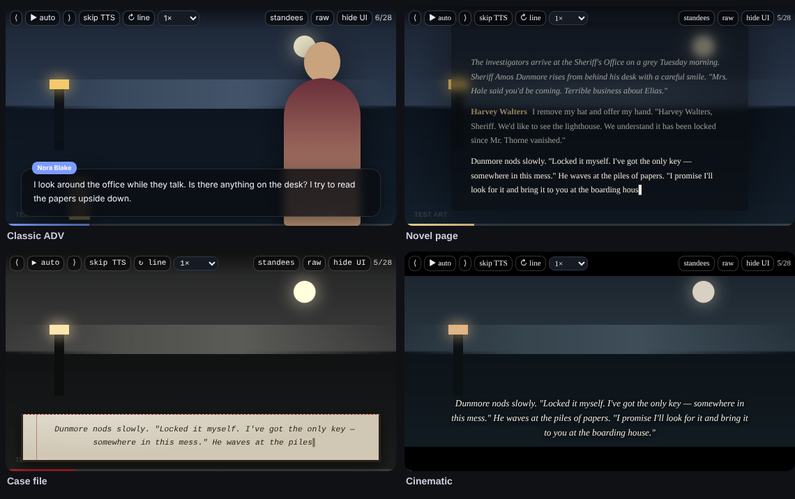
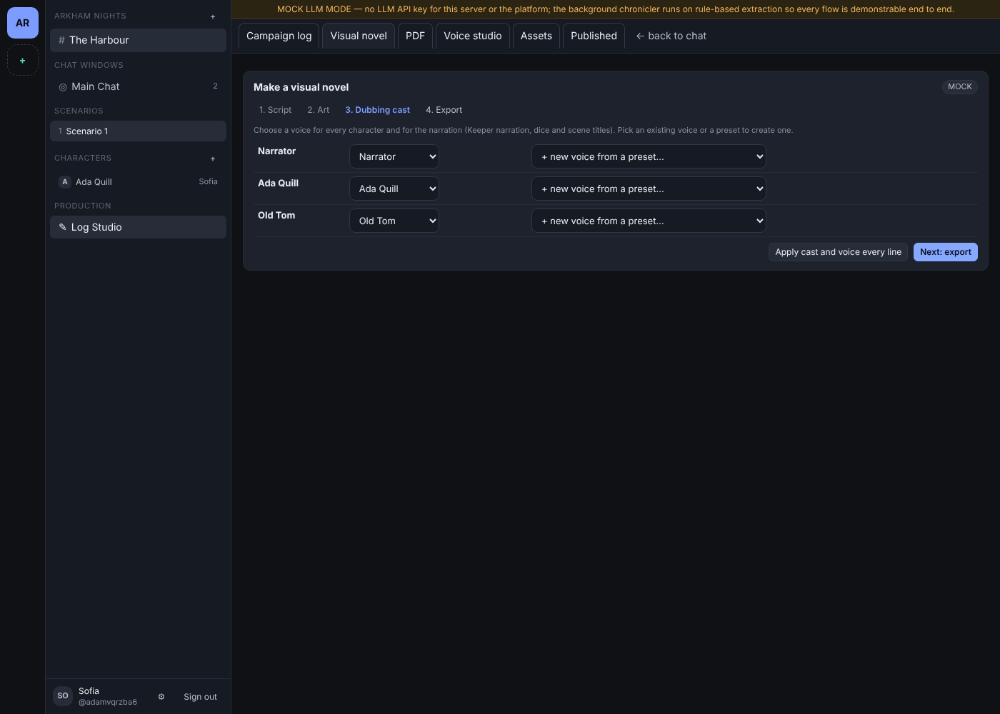
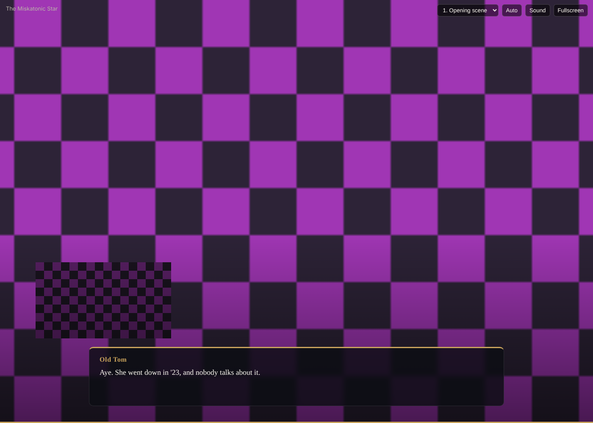

# Visual novel: look templates, LLM scripts and the standalone bundle

A visual novel in Log Studio is a presentation over one frozen snapshot. Two features shape it:

- **Look templates** decide how the player draws every line.
- **Script jobs** have the LLM read the campaign log in the requester's scope and organise it into scenes, backgrounds and portraits. The job then builds a draft presentation in a chosen template, asks the image AI for missing art, and the author casts voices and downloads a standalone zip.

Neither feature changes canonical text. A script references log events by id. The script composer may give a line its
own wording for the visual novel, stored on the presentation (`script_text`) while the log keeps the original:

- the Keeper's narration and action lines are rewritten as fluent, grammatical prose in the log's language;
- short question-and-answer exchanges ("Is the door locked?" / "Yes.") fold into one narration line ("The door is
  locked."); the folded lines stay in the presentation, hidden with the reason `folded into narration (L<n>)`;
- in-character dialogue keeps its words apart from obvious typos, and dice lines are never reworded.

Exact wording is not kept, but facts, names, numbers and decisions are. Only consecutive lines of one chat window with
the same readers can fold together, so a reworded line never carries text its viewer could not read. The editor shows
the wording with the log's original beside it ("Use the log's wording" restores it), and the player's raw log view
always shows the canonical text.



## Look templates

A presentation stores its template in `settings.template`: a base preset plus optional overrides. Keys that are absent take the preset's value, so a later change to a preset reaches presentations that never overrode it. The backend validates every value and drops unknown keys (`PresentationService::validateVnTemplate`). The player re-checks values and turns them only into enumerated class names, clamped numbers and `#RRGGBB` colours. No template value can carry free CSS, HTML or URLs.

| Base | Look | Defaults that differ from Classic ADV |
|---|---|---|
| `adv` Classic ADV | Bottom text box, floating name tag, standees in front | None |
| `nvl` Novel page | Full-height page; the scene's earlier lines stay above the current one | Serif, names inline, dice inline, corner caption for scene titles |
| `dossier` Case file | Typewritten paper slip with a red margin rule over a sepia scene; rolls are stamped | Typewriter face, sepia grade, stamp dice, corner caption |
| `cinematic` Cinematic | Letterbox bars, subtitles without a box | Serif, larger text, names in small caps, cold grade, letterbox |

| Key | Values | Meaning |
|---|---|---|
| `base` | `adv` · `nvl` · `dossier` · `cinematic` | Preset (required) |
| `font` | `sans` · `serif` · `mono` | Typeface family; CJK fallbacks included |
| `text_scale` | 0.8–1.5 | Text size relative to the stage width |
| `box_opacity` | 0–1 | Text box background |
| `accent_color` | `#RRGGBB` | Default name tag, highlighted words, progress bar |
| `name_style` | `tag` · `inline` · `hidden` | Speaker name placement |
| `color_grade` | `none` · `sepia` · `mono` · `cold` · `warm` | Filter on background and standees, never on text |
| `letterbox` | boolean | Black bars above and below |
| `dim_inactive` | boolean | Darken standees that are not speaking |
| `dice_style` | `burst` · `stamp` · `inline` · `hide` | How a roll's total and outcome appear |
| `scene_card` | `fade` · `caption` · `none` | How a new scene's title appears |
| `character_colors` | character id → `#RRGGBB` (≤ 200) | Name colours |

A speaker's name colour comes from the line's own `dialogue_style.name_color`, then from `character_colors`, then from the character's visual profile colour, then from the accent. Text sizes scale with the stage through container query units, so the editor preview and fullscreen keep the same proportions. In the editor, the **Look template** panel under the preview shows the four presets and every override. Changes apply to the preview at once and save half a second after the last edit. Publications copy the presentation, so a published visual novel keeps the template it had when it was published.

## Making a visual novel

Any member can make a visual novel when the Log Studio is open (see [Who can use the Studio](#who-can-use-the-studio)).
The **Make a visual novel** card on the Visual novel tab has four steps.



1. **Script.** Choose which lines the AI reads: everything (Keeper only; the result is Keeper only), lines public to every
   player, or one character's point of view (a player's own characters only). The request freezes the campaign log in
   that scope and queues `POST /vn-scripts`. A worker writes the script and builds a draft presentation.
2. **Art.** Scenes without an approved background, and portraits the script asks for, are painted by the image AI and
   land in the draft as they finish. Characters in uploaded mode use only the portraits their players uploaded.
3. **Dubbing cast.** Pick a voice for every speaking character and for the narration (Keeper narration, dice and scene
   titles), or create one from a provider preset. **Apply cast and voice every line** stores the cast on the draft
   (`POST /presentations/{p}/cast`) and starts a TTS job (Qwen TTS, or the mock provider).
4. **Export.** Preview the draft, open it in the advanced editor, or download a zip
   (`GET /presentations/{p}/bundle.zip`) that holds `index.html`, `script.json`, every image under `assets/` and every
   voice line under `audio/`. The page plays offline in any browser: click, space or arrow keys advance; `A` auto-plays
   with the voices, `M` mutes, `F` goes fullscreen, and a menu jumps between scenes.



### The transcript the model reads

The log is cut into **time blocks**: a block ends when no chat window carried a line for an hour. One model call reads one
block (a long block is split into consecutive parts). Each call gets:

```
# Assets
Era: 1920s New England
Portraits:
- C1 "Ada Quill" mode=generated subtitles=[IDLE] prompt="red-haired librarian in a grey coat"
- C2 "Mo Reyes" mode=uploaded subtitles=[IDLE, FIGHT] (uploaded: only these subtitles may be used)
Backgrounds:
- "Harbour at night" (existing)
- "Lighthouse" prompt="1920s lighthouse at night"      ← invented in an earlier block
# Block (2026-10-27 21:02 – 2026-10-27 22:40)
## Window: Main table
[L1] KP(Narrative)(21:02): Fog rolls over the harbour.
[L2] Mo Reyes(21:03): I keep watch on the pier.
[L3] Mo Reyes(OOC)(21:04): brb, coffee
[L4] KP(as Old Tom)(21:05): Storm's coming.
## Window: Archive (private)
[L5] Ada Quill(21:03): I pull the 1923 ledger.
```

The model answers:

```json
{"generate_backgrounds": [{"name": "Archive", "prompt": "1920s university archive, lamplight, no people"}],
 "generate_portraits": [{"char": "C1", "subtitle": "SAY", "prompt": "…, speaking, full-body standee"}],
 "script": [{"ref": "L1", "background": "Harbour at night"},
            {"ref": "L2", "speaker": "C2", "background": "Harbour at night", "portrait": "IDLE"}]}
```

- **Cast.** Only characters who speak in the frozen lines, or whose full name appears in them, are listed, so a player's
  script cannot name an NPC they have not met.
- **Backgrounds.** Approved backgrounds the scope may show are listed as existing. A snapshot that is not `gm_full` never
  sees GM-only images.
- **Direction.** An optional direction of at most 1,000 characters goes in as data.

The system prompt forbids writing, rewriting, translating, shortening or merging lines, and forbids inventing facts.

### What is accepted from the model

`VnScriptService::fromFlat` turns the answers into scenes, and `normalize` validates them:

- **Scenes.** A new scene opens whenever the background changes; its title is the background name. Parallel chat windows
  therefore read as separate scenes when the model gives them different backgrounds.
- **Lines.** Only refs that exist are placed, each once. An answer that copied a line's text instead of its ref is matched
  back to that line. Out-of-character and system lines the model leaves out are hidden with a reason, never deleted.
  Story lines it skips stay visible next to their neighbours.
- **Portraits.** A speaker is staged with the subtitle given (at most two on stage). For a character in uploaded mode a
  subtitle not in their list falls back to their default art. Portrait requests for uploaded-mode characters are dropped.
- **Art requests.** New backgrounds and generated-mode portraits become image jobs (`asset_needs`, at most 24 per script).
  Background jobs attach to their scene; portrait jobs attach to every placement of that character with that subtitle,
  replacing a stand-in, and are added to the character space.

`PresentationService::applyScript` writes the result over a fresh presentation. It re-checks each asset (approved, same
channel, right type, visible to the presentation's audience) and freezes asset versions.

### Mock mode and cloud policy

- **Mock mode.** Without an LLM API key, a deterministic planner gives each chat window and scenario its own background,
  stages speakers with `SAY` for dialogue and `IDLE` for actions, and requests the missing portraits and backgrounds with
  prompts built from the era and appearance prompt. Its script carries a `MOCK` note.
- **Live model.** The request needs `allow_cloud: true`, and the campaign's Log Studio cloud setting must be on. Both are
  checked again when the job runs. Failed model calls retry once; raise `LLM_TIMEOUT_MS` if parts time out.
- **Images.** With `IMAGE_PROVIDER=mock` images are labelled diagnostic patterns; with no provider the Art step explains
  how to upload art instead.

### Who can use the Studio

The server maintainer can turn the Log Studio off for the whole server (Server settings → Features → Log Studio), and the
Keeper can hide it in one channel (GM workspace → Settings → Log Studio available in this channel). While both are on,
every member reaches it equally, within what they can read: players see and cancel their own script jobs, edit and
cast their own drafts, and share the channel's narrator and player-character voices. While either is off, every
`/studio/*` route answers 403 (`studio_disabled` or `studio_hidden`) and the sidebar hides the item. Chat and media are
unaffected.

### Limits

- A job accepts at most 4,000 lines.
- The draft is a starting point. Review it in the advanced editor before publishing.

The stored script format is in [VN_SCRIPT_SCHEMA.json](VN_SCRIPT_SCHEMA.json). The template keys are also in [PRESENTATION_SCHEMA.json](PRESENTATION_SCHEMA.json) under `settings.template`.

## Script limits and retrying

Set `LLM_VN_MAX_TOKENS=32768` and `LLM_VN_TIMEOUT_MS=300000` in the backend environment (restart to apply). These are per model request, including schema repair calls, and are independent of `LLM_MAX_TOKENS`, `LLM_TIMEOUT_MS` and the module-import limits. Changing the daily token allowance does not change visual-novel requests. The configured model must support the chosen output allowance.

`VN_SCRIPT_RETRY_FAILED_CHUNKS=true` is the default for new jobs. The Studio checkbox “Keep completed parts when retrying” overrides it for a job. Each successful part is saved in the database before proceeding. Automatic retries and the “Retry script” button reuse the unchanged completed prefix and resume at the failed part; unfinished later parts still run. Turning this off starts each attempt from the beginning. The existing two-attempt allowance still applies; a manual retry resets that allowance for the same snapshot.

Retries recheck membership, snapshot visibility and cloud permission. Changed prompts, model/language, cast, asset references or preceding generated context invalidate the affected cached suffix. Completed parts survive backend restarts; jobs created before this feature have no saved parts to recover. This option resumes script planning, not image or voice jobs. A long-running request is not reclaimed before its configured timeout and possible schema-repair rounds have elapsed.
